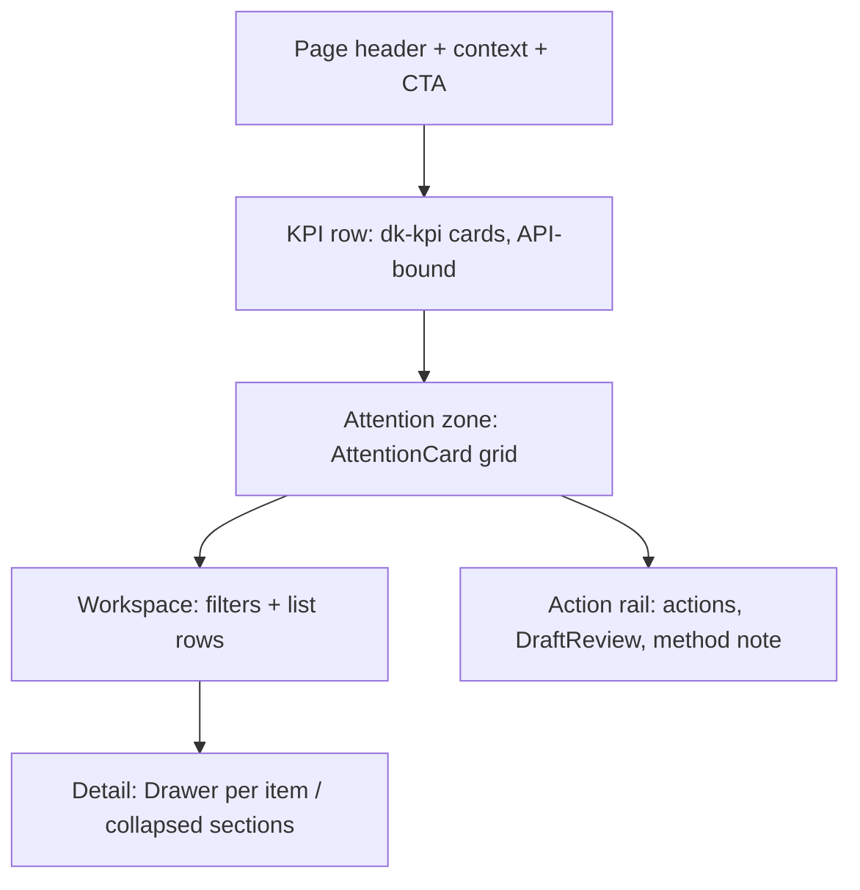

# MediBytes HMS redesign: Lab Results, Claim Review, Revenue Leakage

Status: **Phase 1 design, revision 2, for final approval.** No application or backend code has been changed for this phase.
Branch: `feat/opd-local-medibytes`. Wireframes: [labs](labs-wireframe.md) · [claim review](claim-review-wireframe.md) · [revenue leakage](revenue-leakage-wireframe.md).

> **About the numbers in these documents.** Every INR amount and count in the wireframes is an *example*, taken from the seeded QA database or the DEMO fixtures to make the layout concrete. **Nothing is hardcoded.** Each figure is bound at runtime to the API field or formula in §3. When a field is missing, the card shows an *unavailable* state, never a substitute value.

Revision 2 changes: runtime data bindings for every KPI (§3); the rule for when data is unavailable (§4); the bed-days estimate rule (§5, [leakage](revenue-leakage-wireframe.md#open-admission-estimate)); strict reference-range bar rules ([labs](labs-wireframe.md#reference-range-bar-rules)); DEMO behaviour per page (§6); claim status model (§7, [claim](claim-review-wireframe.md#status-model)).

---

## 1. Why the Stage 2 Labs page still looks like the old page

| What Stage 2 kept | Effect |
|---|---|
| One white panel holding everything, with the same `Test / Value / Reference / Status / Action` table | The page silhouette is unchanged: header, banner, one long table |
| Grouping done by splitting the table into four smaller tables | Reads as "the same table, cut up" |
| Overview reduced to one sentence in a banner | No at-a-glance numbers |
| Abnormal results shown as amber text in a row | Abnormal and normal rows are the same shape and size |
| Reference range as plain text in a column | You compare two numbers in your head |
| No use of the product's dashboard patterns (`dk-kpi` cards, `Drawer`) | The page doesn't match the newer Dashboard and Patients pages |

The behaviour added in Stage 2 (filters, search, permission gating, bulk review, grouping logic in `labStatus.ts`) is sound and is **kept**. The layout and components on top of it change.

---

## 2. Shared design direction (all three pages)

```
┌──────────────────────────────────────────────────────────────────────────┐
│ ① PAGE HEADER   title · one-line context · status pill        [CTA(s)]   │
├──────────────────────────────────────────────────────────────────────────┤
│ ② KPI ROW       3–4 cards bound to API data; hero metric = navy card     │
├──────────────────────────────────────────────────────────────────────────┤
│ ③ ATTENTION ZONE   what needs a human now: alert / blocker cards         │
├───────────────────────────────────────────────┬──────────────────────────┤
│ ④ WORKSPACE (8/12)                            │ ⑤ ACTION RAIL (4/12)     │
│   filters + structured list / comparison      │   primary actions        │
│   rows that expand or open a detail drawer    │   AI draft (DraftReview) │
│                                               │   "how this is computed" │
├───────────────────────────────────────────────┴──────────────────────────┤
│ ⑥ DETAIL (collapsed by default): full tables, history, raw records       │
└──────────────────────────────────────────────────────────────────────────┘
```



**Responsive rules**

| Width | Layout |
|---|---|
| ≥ 1180px (desktop) | KPI row 4 across; workspace 8/12 + rail 4/12 |
| 768–1179px (tablet) | KPI 2 × 2; rail drops below the attention zone (primary action stays near the top) |
| < 768px (phone) | KPI 2 × 2 compact; attention cards full width; list rows become cards; drawer becomes a full-screen sheet; primary actions full width |

**Alert hierarchy (one scale for the whole product)**

| Level | Used for | Treatment |
|---|---|---|
| Critical | Lab flag `critical` (only when the API sends it); claim contradictions | Red left stripe, `--critical-soft` tint, solid red badge |
| Warning | High/low/abnormal labs; missing documents; unbilled/underbilled; unsupported lines | Amber stripe, white card, amber badge |
| Estimate | Calculated, not yet confirmed figures (open-admission bed-days) | Dashed amber outline + "Estimate" badge (§5) |
| Info | Normal results awaiting review; method notes | Blue badge, no tint |
| Quiet | Reviewed / normal | Grey text, folded by default |
| Unavailable | Field missing from the data | Grey "—" with the reason (§4) |

Colour is always paired with a word, and an icon or ▲/▼ where useful.

**Button hierarchy:** one **primary** (blue) action per zone: Mark reviewed (labs card), Prepare review pack (claim rail), Explain findings (leakage rail). Everything else is secondary (outlined). No button claims an action the backend can't do.

**Components**

| Component | New / reused | Notes |
|---|---|---|
| `PageHeader` | reused | context line via `meta` |
| KPI card | **reused** `dk-kpi` styles ([dashkit.css](../../frontend/src/styles/pages/dashkit.css)) | wrapped in a small `KpiCard` that also renders the unavailable state |
| `AttentionCard` | **new** (`frontend/src/components/insight/`) | severity stripe, title, key figure, meta, actions, optional expand |
| `SectionHead` | **new** | title, count, sub, actions |
| `ActionRail` | **new**, layout only | sticky on desktop |
| `CompareBar` | **new** | billed vs expected; drawn only when both amounts are numbers |
| `RangeBar` | **new** | lab reference band + marker; strict rules in [labs](labs-wireframe.md#reference-range-bar-rules). Uses the existing `parseRange`; **does not** reuse `ReferenceValue`, which prints a made-up axis maximum and draws one-sided ranges |
| `TrendChart` | reused | lab history drawer only, ≥ 2 real results |
| `BarList` | reused | leakage by service type, only when amounts exist |
| `Drawer` | reused | lab history, leakage finding detail |
| `EvidenceChip`, `DraftReview`, `ContradictionList` | reused | unchanged behaviour |
| `Pill`, `Banner`, `EmptyState`, `Skeleton`, `Tabs`, `SearchInput`, `Modal` | reused | |
| Styles | **new** `styles/pages/insight.css` + per-page CSS | existing tokens only |

---

## 3. KPI data contract (runtime bindings; nothing hardcoded)

| Page | Card | Value at runtime | Unavailable when |
|---|---|---|---|
| Labs | Pending review | count of `labs[]` with `review_status === "unreviewed"` | `/investigations` not loaded |
| Labs | Abnormal | count with `flag` ∈ {`critical`,`high`,`low`,`abnormal`} (the same set rule R3 uses) | 〃 |
| Labs | Critical | count with `flag === "critical"`; when 0 the note reads "None flagged critical by the source" | 〃 |
| Labs | Total tests | `labs.length` (latest result per test) | 〃 |
| Claim | Bill total | `total_amount` | field missing or not a number |
| Claim | Expected total | `expected_total_amount`; note "from bill lines' expected amounts" | 〃 |
| Claim | Below expected | `underbilled_amount`; note = `underbilled_items.length` lines | 〃 |
| Claim | Documents | `required_documents.filter(d => d.present).length` of `required_documents.length`, with a progress bar | `required_documents` missing |
| Claim | Blockers (hero) | `missing_documents.length + contradictions.length + unsupported_items.length` | any list missing → count only what is present and say so |
| Leakage | Revenue at risk | `leakage_amount` (backend total of unbilled + underbilled gaps) | `leakage_amount` not a number (DEMO) |
| Leakage | …of which open-admission estimate | sum of `variance` for findings with `service_kind === "bed_day"` while `meta.encounter.discharged_at` is empty (§5) | `variance` missing |
| Leakage | Findings | `findings.length` | — |
| Leakage | Root-cause cards | per category: count of findings, and sum of `variance` (or of `billed_amount` for unsupported) | amounts missing → count only + "Amount unavailable" |
| Leakage | By service type | sum of `variance` grouped by `service_kind` | `service_kind` or `variance` missing → section hidden (no empty chart) |

Amounts are formatted with the existing `inr()` helper (`en-IN`, no decimals). Counts are never padded or rounded.

## 4. Unavailable and loading states (all pages)

| Situation | Shown |
|---|---|
| Loading | skeleton card of the same size; no zero |
| Request failed | card value "—", red banner in the zone with the error message |
| Field missing, live mode | "—" with note **"Amount unavailable"** (or "Not available") |
| Field missing, DEMO mode | "—" with note **"Amount unavailable in preview"** |
| Genuine zero from the API | "0" / "INR 0"; this is a real value, not a fallback |
| Chart with no data | not rendered; a one-line text explains why |

A missing amount is **never** replaced by 0, by another field (e.g. expected labelled as approved), or by a sum of partial data presented as the total.

## 5. Calculated estimates vs confirmed discrepancies

The backend counts bed-days for an **open admission** (no `discharged_at`) from `admitted_at` up to the current clock. On the QA data that gives 36 bed-days × INR 3,500 = INR 126,000 expected against INR 8,000 billed, a gap of INR 118,000.

Design rule (frontend presentation only; backend unchanged):
- A finding is an **open-admission estimate** when `service_kind === "bed_day"` and the encounter has no `discharged_at`.
- It stays in the list and in the backend's `leakage_amount`. It is **not** excluded or altered.
- It is marked **Estimate · open admission**, with a dashed outline, and always displays **days calculated × unit rate = expected**, the admission date, and "counted to today; not discharged".
- The hero splits the total into *billing discrepancies* and *open-admission estimate*, so the two are never read as one confirmed figure.
- Once the encounter has a `discharged_at`, the same finding is shown as an ordinary discrepancy.
- Changing the backend calculation needs your separate approval.

## 6. DEMO mode (bundled preview data, no backend)

| Page | What the fixture has | How the page looks |
|---|---|---|
| Labs | 6 results; one-sided eGFR range; Potassium 5.1 flagged High at the top of 3.5–5.1; one result per test | All four KPI cards populated. Range bars only where the [rules](labs-wireframe.md#reference-range-bar-rules) allow (eGFR and Potassium show text). No history arrows or drawer. Mark reviewed / Upload / bulk review are refused by the existing preview message |
| Claim | Full claim data, amounts included; contradictions **without** evidence quotes; no review packs; no F12 draft | All KPI cards and the hero populated. Contradiction cards show evidence chips instead of quotes. Review history "No packs prepared". Explanation panel empty state. Prepare / Explain refused; Open review copy opens the static preview copy (existing) |
| Leakage | 4 findings with only `procedure`, `billing_status`, `explanation`, evidence; **no** `leakage_amount`, `kind`, `code`, amounts or `service_kind`; no F13 draft | Hero shows **"4 findings"** with **"Amount unavailable in preview"**. Root-cause cards from `billing_status` (counts only). Service-type section hidden. Finding cards show status, explanation and evidence, without compare bars. Detail drawer shows "Amounts unavailable in preview". CSV export still works and leaves the amount columns empty. Explain refused |

## 7. Claim status model (backend values only)

Two independent backend fields, shown as two distinct indicators:

| Field | Values | Shown as |
|---|---|---|
| `status` (claim readiness) | `review_ready` · `on_hold` · `needs_clarification` | The **readiness hero**: green "Ready for human review" · amber "On hold" · red "Clarification required" |
| `tpa_review.status` | `ready_for_review` · `needs_clarification` | A separate labelled chip **"TPA review: …"** inside the hero and in the rail |
| `reviews[]` | prepared review packs, newest first | "Review pack: not prepared" or "Review pack clm_… prepared {date}: {status at that time}" |

There are **no** Approved, Rejected, Pending or Submitted states in the backend, and none are shown. Details in the [claim wireframe](claim-review-wireframe.md#status-model).

---

## 8. MoSCoW: Lab Results

| Priority | Feature | Support | Plan |
|---|---|---|---|
| MUST | Overview: total, abnormal, critical, pending review | ✅ `/investigations` | 4 KPI cards bound per §3; Pending review is the hero; cards set the filter |
| MUST | Prominent abnormal/critical section at top | ✅ | "Needs your review" card grid |
| MUST | High / low / critical / normal / unknown indicators | ✅ `flag` | Badge with glyph + word. **Critical only if `flag === "critical"`** |
| MUST | Reference range beside value | ✅ | Original text always shown; `RangeBar` only under the strict rules |
| MUST | Missing reference range handled | ✅ | "No range given"; no bar |
| MUST | One-click Mark reviewed | ✅ `POST /labs/{id}/review` | Primary button on each attention card; role-gated (`review_lab`) |
| MUST | Reviewed vs unreviewed distinct | ✅ | Attention cards = unreviewed; reviewed rows show a tick; reviewed normals fold |
| SHOULD | All / Abnormal / Unreviewed filters, search | ✅ (Stage 2) | Kept |
| SHOULD | Bulk review of normal results with confirmation | ✅ (Stage 2) | Kept |
| SHOULD | Clinical panels (Renal, Diabetic…) | ❌ no category field | **Not built**; grouping by review state and flag |
| SHOULD | Better result presentation than a table | ✅ | Attention cards + compact result rows |
| COULD | Previous vs current, history | 🟡 real timeline data (`types=lab_result`) | Only when an earlier result exists; history drawer only with ≥ 2 results |
| WON'T | AI diagnosis; invented thresholds; fabricated history | — | Not built |

## 9. MoSCoW: Claim Review

| Priority | Feature | Support | Plan |
|---|---|---|---|
| MUST | Claim status | ✅ `status`, `tpa_review.status` | Readiness hero + separate TPA chip (§7) |
| MUST | Total and approved amount | ⚠️ no approved amount field | Bill total / Expected / Below expected (§3). **No approved card**; method note explains |
| MUST | Immediate blockers | ✅ | Blockers zone ranked: contradictions → missing documents → unsupported lines |
| MUST | Ready / on hold / clarification distinct | ✅ | Hero colour, icon and wording per state |
| MUST | Prominent prepare/review action | ✅ | Primary at the top of the rail (top of page on mobile); `revenue_work` only |
| SHOULD | Document checklist with completion | ✅ | "n of m" progress + checklist with evidence |
| SHOULD | Coding validation | 🟡 limited | Coding checks card; says ICD is not checked |
| SHOULD | Code editing | ❌ no API | Not built |
| SHOULD | Grouped blockers with links | ✅ | Evidence chips + "Fix in…" links to existing pages |
| — | Remove duplicate "Documented but unbilled" | approved | Link card to Revenue leakage |
| COULD | Rejection risk, payer history | ❌ no data | Not built |
| WON'T | Payer submission; fabricated amounts | — | Not built |

## 10. MoSCoW: Revenue Leakage

| Priority | Feature | Support | Plan |
|---|---|---|---|
| MUST | Large total missed revenue | ✅ `leakage_amount` (live) / ❌ DEMO | Hero, split into discrepancies vs open-admission estimate (§5); DEMO = unavailable state |
| MUST | Number of findings | ✅ | Under the hero |
| MUST | Itemised missing services | ✅ | Findings list sorted by gap |
| MUST | Expected, billed, variance | ✅ live | Expected → Billed → Gap + `CompareBar`; unavailable state otherwise |
| MUST | Reconcile / add-to-claim | ❌ no endpoint or stored status | **Not built**; "Review only" notice |
| MUST | Evidence per finding | ✅ | Chips in row and drawer |
| SHOULD | Department / service type | 🟡 `service_kind` only | "By service type" bars (live only) |
| SHOULD | Root-cause categories | ✅ `kind` (live) / `billing_status` (DEMO) | Four category cards = filters |
| SHOULD | Filters, grouping, detail panel | ✅ | Category + type + search; `Drawer` |
| COULD | CSV / print | 🟡 browser only | Export CSV, Print |
| WON'T | Automated billing, fake resolved status, cross-hospital analytics | — | Not built |

---

## 11. Data and API dependencies (no backend changes)

| Page | Reads | Writes (existing, unchanged) |
|---|---|---|
| Labs | `GET /investigations`; `GET /patients/{id}/timeline?types=lab_result` (COULD); `GET /meta` | `POST /labs/{id}/review`; `POST /documents/upload` via `uploadReport` |
| Claim | `GET /revenue/claim-prep`; `GET /drafts?feature=F12&limit=1`; `GET /meta` | `POST /revenue/claim-prep/prepare`; `POST /revenue/claim-prep/explain`; `GET /revenue/claim-prep/pack.html` |
| Leakage | `GET /revenue/leakage`; `GET /drafts?feature=F13&limit=1`; `GET /meta` | `POST /revenue/leakage/explain` |

Frontend type changes are additive only: `Leakage` in [types.ts](../../frontend/src/types.ts) gains the fields the API already returns, **all optional** (the DEMO fixture lacks them).

## 12. Unsupported or deferred

| Item | Why | Closest honest alternative |
|---|---|---|
| Lab panels | No category field | Group by review state and flag |
| Approved / sanctioned amount | No field | Bill total, expected, below expected, each labelled by source |
| Approved / Rejected / Pending statuses | Not in backend | Readiness + TPA status (§7) |
| ICD validation / code editing | No data or API | Coding checks card + plain statement |
| Rejection risk, payer insights | No data | Not shown |
| Reconcile / add to bill / resolved state | No endpoint or stored state | "Review only" notice, evidence, F13 draft |
| Departments | Not in data | Service type |
| Changing the bed-days calculation | Backend logic; needs separate approval | Estimate labelling (§5) |
| Range bars for one-sided or free-text ranges | Would need an invented scale end | Original text |

## 13. Implementation phases (each stops for approval)

1. **Phase 2, Labs**: shared `insight` components and CSS, then the Labs page (reuses `labStatus.ts`, `BulkReviewDialog.tsx`), with an optional history lookup.
2. **Phase 3, Claim Review**: `features/f12/ClaimReview.tsx` extracted from [Revenue.tsx](../../frontend/src/pages/Revenue.tsx).
3. **Phase 4, Revenue Leakage**: `features/f13/LeakageView.tsx`, additive type, estimate rule, drawer, CSV, print.

No routes, navigation, roles, backend code or dependencies change. Live and DEMO modes are checked at every phase.
