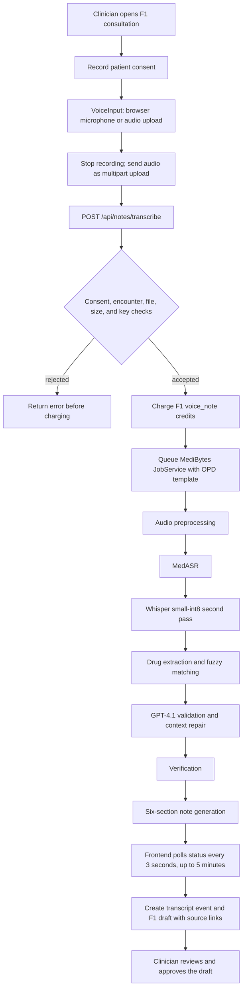

# Voice Pipeline Rollout — Execution Report

**Run date:** 2026-11-13
**Repository:** `medibytesinternational-netizen/simple-demo`
**Branch:** `codex/voice-pipeline-rollout`
**Base:** `feat/opd-local-medibytes`
**Result:** Local checks completed; feature rollout and live voice end-to-end test are blocked at the plan's Task 0 parity gate.

## Executive summary

I inspected the rollout plan and current F1 voice implementation, installed/reused the project dependencies, ran the available backend and MediBytes test suites, built the frontend, and started both the integrated app and the standalone MediBytes API for smoke checks.

The existing F1 app boots and the APIs respond. The backend and non-parity test suites pass. The discharge prompt pin passes. The Phone40 replay suite fails because the committed baseline contains replies for an older discharge prompt. The plan explicitly makes a green Phone40 parity suite a prerequisite to template/generalization work. The current discharge prompt is intentionally pinned; restoring the older prompt would undo the intended prompt change. Re-recording and rescoring the baseline requires a live GPT-4.1 API key, which is not available.

**No live speech was processed, no discharge note or downloadable job output was generated, and no voice E2E pass is claimed.** The user's environment has no OpenAI key and no supplied live voice sample. The API correctly refuses new work without a key.

## Current workflow

The UI records audio in the browser and uploads it after the recording stops; this is not continuous streaming transcription. The current F1 UI shows a general “Transcribing…” state, not per-stage progress. The active voice feature is F1 only and uses the OPD template. The status route, credit charge, timeline lookup, section labels, and draft mapper still have F1-specific assumptions identified in the plan.

## Validation performed

| Check | Result | Details |
|---|---|---|
| Python dependencies | Installed/reused | Installed with `pip install -r backend/requirements-dev.txt -r requirements-medibytes.txt` in the workspace virtual environment. |
| Frontend dependencies | Installed | `npm ci` completed; npm reported 3 moderate dependency advisories. |
| Backend tests | **659 passed** | `pytest -q backend/tests --tb=no` |
| MediBytes/API/HIMS tests excluding Phone40 parity | **497 passed** | `pytest -q tests --ignore=tests/test_parity_phone40.py --tb=short`; one Starlette/AnyIO deprecation warning. |
| Discharge prompt pin | **2 passed** | `pytest -q tests/unit/test_discharge_template_pin.py --tb=short` |
| Phone40 parity | **42 errors** | `pytest -q tests/test_parity_phone40.py --tb=no`; all 40 clip cases plus aggregate checks encounter `ReplayMiss` for the discharge prompt. The first error is `no recorded reply for a discharge prompt`. |
| Frontend typecheck and production build | **Passed** | `npm run build` runs `tsc -b` and Vite; 150 modules built. |
| Integrated app smoke | **Passed** | Started `backend.app.main:app`; `GET /api/health` and `GET /` both returned HTTP 200. |
| Standalone MediBytes API smoke | **Readiness passed; processing blocked** | `GET /api/health` returned HTTP 200 with `llm.configured=false`; `GET /api/jobs` returned HTTP 200 and an empty list; `POST /api/jobs` returned the expected HTTP 503 because `OPENAI_API_KEY` is unset. |
| Missing-key voice guard | **Passed** | `test_without_a_key_upload_is_refused_and_costs_nothing` passed; a request without a key is refused without charging credits. |
| Live audio, completed job, generated note, downloadable output | **Not run** | The key gate prevents job creation; no live speech was supplied. |

The Phone40 test failure is a known prompt/baseline mismatch, not a failure introduced by this branch. The checked-in pin snapshot passes and the current prompt is the intended pinned prompt. The frozen evaluation trace predates it. The plan calls for re-recording the baseline with `evaluation/phone40/run_live_discharge.py` and rescoring; it estimates one GPT-4.1 pass over 40 clips and says the 212/229 result may change.

## Task status and remaining work

1. **Task 0 — parity guard: blocked.** Provide an OpenAI API key locally, run the live discharge re-record and score it, update the evaluation baseline intentionally, and make `pytest tests/test_parity_phone40.py` green.
2. **Task 1 — generalize plumbing: not started.** The plan forbids template work before Task 0 passes. It includes a feature form field and pre-charge validation, feature-aware status handling, template labels/mappers, and `VoiceInput` feature support.
3. **Task 2 — additional dictation features: not started.** Candidate order is F4, F3, F2, F9, F11, F10. F7 is deferred; F5, F6, F12, and F13 are not dictation workflows in the plan.
4. **Task 3 — operations: not started.** Per-feature audit labels, queue measurement, surfaced job failures, and a retry that does not double-charge remain future work.
5. **Live UI end-to-end acceptance: pending.** Once credentials and speech are available, record or upload an actual voice clip in F1, verify transcript/entity/verification content and the generated draft, inspect the saved note/output files, and confirm the clinician review/approval path. A generated note must be inspected before describing output quality.

## Environment required to continue

- `OPENAI_API_KEY` for the measured GPT-4.1 stages and the Task 0 live baseline re-record. Keep it in a local `.env` or shell environment; do not commit it or send it in chat.
- A live speech recording or a consented microphone session for the browser voice E2E. The repository also contains Phone40 evaluation clips for evaluation replay, but those do not replace a live browser/microphone check.
- `HF_TOKEN` and `HF_HOME` are supported settings for Hugging Face access/cache if the MedASR model cannot be fetched anonymously. No HF token or local model cache was present in this run.

## PR contents

This branch adds this execution report only. No pipeline source, prompt, evaluation threshold, or model configuration was changed because the plan's parity gate is red and the required OpenAI key is unavailable. The PR is draft so the blocker and test evidence are visible without presenting the rollout as complete.
